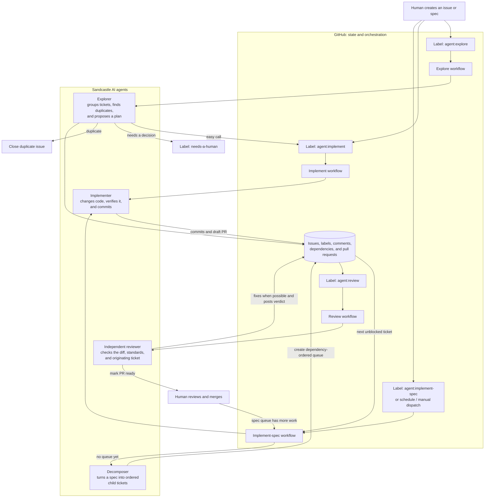

# Spring Factory
This repository combines a Java 21 Spring Boot application and a React
frontend with a GitHub-hosted software factory. GitHub Actions orchestrates the
work, while Sandcastle runs specialized AI agents for exploration,
implementation, decomposition, and review.
## How the software factory works

The workflows are deliberately memoryless: GitHub issues, labels,
dependencies, comments, branches, and pull requests hold the durable state.
Agents do not receive a GitHub token; separate workflow steps validate their
output and perform repository writes. Pull requests remain the human merge
checkpoint.
The workflow definitions live in `.github/workflows/agent-*.yml`, and their
Sandcastle agents and prompts live in `.sandcastle/agent-workflows/`.
